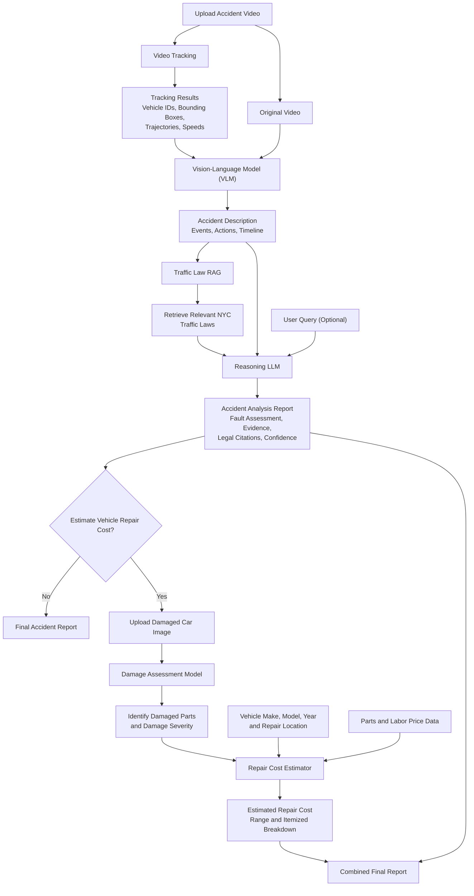

# Accident Intel

> Evidence-first analysis of traffic-accident footage, with vehicle tracking, traffic-law retrieval, and damage-cost estimation.

Accident Intel is a Python project for turning accident video and vehicle photos into reviewable analysis. It keeps observations, retrieval, and reasoning separate: the visual model describes what is visible, retrieval supplies relevant New York traffic-law passages, and an LLM produces a qualified assessment grounded in that evidence.

> **Important:** This project is an analysis aid, not legal advice or a final determination of liability. A qualified human reviewer must verify all findings, source footage, estimates, and legal conclusions.

## What it does

- Analyzes CCTV or dashcam clips with a vision-language model (VLM) and produces cautious, chronological observations.
- Detects and tracks vehicles with YOLO and BoT-SORT, saving trajectories and an annotated video.
- Retrieves relevant New York Vehicle and Traffic Law (VTL) passages with hybrid dense/BM25 search.
- Extracts structured accident facts and generates an evidence- and citation-grounded liability analysis.
- Analyzes photos of vehicle damage and creates an editable repair-cost estimate in EGP through a Streamlit UI.
- Includes utilities for VLM benchmarking and RAG evaluation.

## Architecture



The React UI and FastAPI backend connect uploads to tracking, visual analysis, law retrieval, and reasoning. Progress, intermediate results, and reports persist in SQLite. See [the backend setup](src/api/README.md) for model configuration and startup instructions.

## Repository layout

```text
src/
├── VLM/                 # Qwen2-VL video analysis, prompts, frame contact sheets
├── vehicle_tracking/    # YOLO11x + BoT-SORT detection and trajectories
├── rag/
│   ├── chunking/        # Traffic-law chunking and query expansion
│   └── retrieval/       # Chroma/BM25 retrieval and accident-law analysis
├── reasoning/           # LLM reasoning experiments
└── Car_damage_cost/     # Damage segmentation, review UI, and cost estimation
evaluation/
└── rag_evaluation/      # RAGAS test set and evaluation script
out/                     # Generated law chunks/index metadata
vtl_db/                  # Local Chroma vector database
```

## Getting started

### Prerequisites

- Python 3.13+ (as declared in `pyproject.toml`)
- A CUDA-capable GPU is strongly recommended for local Qwen2-VL and YOLO inference.
- API keys only for the optional hosted-model features:
  - `GROQ_API_KEY` for traffic-law fact extraction and analysis
  - `GEMINI_API_KEY` for optional replacement-part price lookup

Create an environment and install the project dependencies:

```bash
python -m venv .venv
source .venv/bin/activate        # Windows: .venv\\Scripts\\activate
pip install -r requirements.txt
```

Some workflows have additional optional packages. Install only what the workflow requests—for example, the RAG liability-analysis script requires `openai`, `python-dotenv`, and `rank-bm25`.

Create a local `.env` for secrets; never commit it:

```dotenv
GROQ_API_KEY=your_groq_key
GEMINI_API_KEY=your_gemini_key
```

## Run the components

### 1. Analyze accident video with the VLM

The VLM samples frames from a video and produces a conservative report. It uses `Qwen/Qwen2-VL-7B-Instruct` by default and downloads model assets on first use.

```bash
cd src/VLM
python analyze_video.py \
  --video /path/to/accident.mp4 \
  --prompt-mode json \
  --n-frames 32 \
  --output ../../report.txt
```

Use `--prompt-mode report` for the longer narrative prompt, or pass `--prompt-file` to supply a custom prompt.

### 2. Track vehicles

`process_video` saves both an annotated MP4 and a JSON file containing track IDs, bounding boxes, and center-point trajectories.

```python
from src.vehicle_tracking.tracker import process_video

process_video(
    input_path="/path/to/accident.mp4",
    output_video="artifacts/tracked.mp4",
    output_json="artifacts/trajectories.json",
)
```

The tracker uses YOLO11x vehicle classes (car, motorcycle, bus, and truck) with BoT-SORT. Ultralytics may download the default `yolo11x.pt` weights on first run.

### 3. Search the traffic-law index

The hybrid retrieval path combines dense embeddings (`BAAI/bge-m3`) with BM25 and Reciprocal Rank Fusion. A prepared index is stored under `out/`.

```bash
python -m src.rag.retrieval.index_and_retrieve search \
  --out out \
  -q "failure to yield right of way" \
  -q "traffic-control signal red indication" \
  --top-k 5
```

To rebuild the Chroma index after changing chunks:

```bash
python -m src.rag.retrieval.index_and_retrieve index --out out
```

### 4. Produce a law-grounded accident analysis

Provide either a text description or a file. The script extracts neutral facts, retrieves relevant VTL sections, then asks the reasoning model for a cited assessment. It supports English and Arabic output.

```bash
mkdir -p artifacts
python -m src.rag.retrieval.analyze_accident \
  --out out \
  --file accident_description.txt \
  --lang en \
  --save artifacts/accident-analysis.md
```

The generated report should always be treated as a review draft. Confirm that its citations and factual statements match the retrieved passages and source video.

### 5. Estimate vehicle damage cost

The Streamlit application accepts vehicle photos, segments damage and parts, lets a reviewer correct the detections, then produces an EGP estimate.

```bash
cd src/Car_damage_cost
cp env.example .env
# Add your own keys and adjust local model-weight paths in .env
streamlit run app.py
```

Do not copy the sample placeholder values as credentials. The app can operate with its local placeholder price table when `GEMINI_API_KEY` is not configured.

## Evidence and safety principles

- Visual outputs should distinguish observed facts from unclear or unobserved details.
- A collision, signal state, speed, driver intent, or fault must not be inferred from ambiguous footage.
- Law retrieval constrains the liability analysis to the supplied passages; it does not replace legal review.
- Damage predictions and cost ranges are estimates and should be checked against an inspection and local repair quotes.
- Keep videos, personal information, plates, and API keys protected in accordance with applicable privacy requirements.

## Evaluation

RAG evaluation assets are in `evaluation/rag_evaluation/`, including a RAGAS test set. VLM support files in `src/VLM/` include contact-sheet and environment helpers for inspecting visual-model runs.

## Roadmap

- Add calibrated speed estimation and explicit uncertainty bounds.
- Add persistent reviewer edits to the existing analysis history.
- Add source-video timestamps to every material observation and report claim.
- Expand benchmark coverage for model latency, token use, retrieval quality, and human-review agreement.

## License

No license has been specified yet. Add a license file before distributing or reusing this project outside its intended scope.
