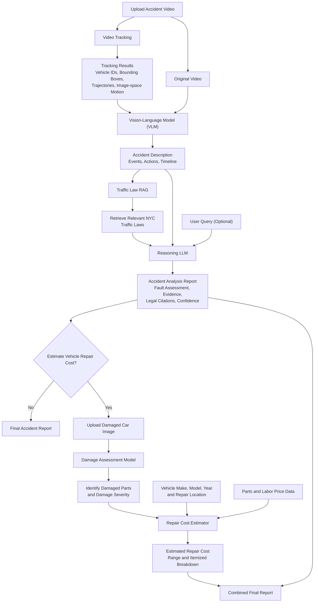

# Accident Intel

> Evidence-first analysis of traffic-accident footage, with vehicle tracking, traffic-law retrieval, and damage-cost estimation.

Accident Intel is a Python project for turning accident video and vehicle photos into reviewable analysis. It keeps observations, retrieval, and reasoning separate: the visual model describes what is visible, retrieval supplies relevant New York traffic-law passages, and an LLM produces a qualified assessment grounded in that evidence.

> **Important:** This project is an analysis aid, not legal advice or a final determination of liability. A qualified human reviewer must verify all findings, source footage, estimates, and legal conclusions.

## What it does

- Analyzes CCTV or dashcam clips with a vision-language model (VLM) and produces cautious, chronological observations.
- Detects and tracks vehicles with YOLO and BoT-SORT, saving trajectories and an annotated video.
- Retrieves relevant New York Vehicle and Traffic Law (VTL) passages with hybrid dense/BM25 search.
- Extracts structured accident facts and generates an evidence- and citation-grounded liability analysis.
- Analyzes vehicle-damage photos and creates a repair-cost estimate in EGP through the React UI.
- Includes utilities for VLM benchmarking and RAG evaluation.

## Architecture



The React UI and FastAPI backend connect uploads to tracking, visual analysis, law retrieval, and reasoning. Progress, intermediate results, and reports persist in SQLite. See [the backend setup](src/api/README.md) for model configuration and startup instructions.

React uploads the actual video to FastAPI; the Python models run on the backend:

1. Save the uploaded video and run the existing vehicle-tracking preprocessing.
2. Pass that same video and its tracking observations to `src/video_understanding`: local Qwen2-VL on a CUDA GPU, or timestamped sampled frames through a hosted vision API.
3. Send the VLM description to `src/rag/retrieval/report_retrieval.py` to retrieve law passages.
4. Send the description, retrieved passages, tracking context, and optional user notes to `src/reasoning/reasoning_accident.py`.
5. Save the structured report and display it, together with the full VLM description, in React.

Repair-cost analysis remains a separate branch; model failures are surfaced without substituting sample estimates.

## Repository layout

```text
frontend/src/
├── app/                 # React entry and routes
├── pages/               # Upload, history, reports, laws, damage, settings
├── components/          # Upload controls, tracking player, stage results
├── hooks/               # API health and analysis state
├── services/            # Typed API clients and response mapping
└── types/               # Video, pipeline, tracking, law and report contracts
src/
├── api/                 # FastAPI routes, persistent jobs, model adapters
├── vehicle_tracking/    # YOLO11x + BoT-SORT and candidate heuristics
├── video_understanding/ # GPU Qwen2-VL / hosted API and frame sampling
├── rag/                 # Chunking, hybrid retrieval, report queries
├── reasoning/           # Evidence-grounded structured reasoning
├── car_damage_cost/     # Damage segmentation and repair estimates
└── accident_intel/      # API command-line entry point
data/
├── traffic_laws/raw/    # Provisioned law source files (not committed)
├── traffic_laws/chunks/ # parents.json, children.jsonl, Chroma index
└── accidents/          # Uploaded videos and tracking artifacts
weights/
├── vehicle_tracking/   # yolo11x.pt
└── car_damage_cost/    # damage_segmentation.pt, parts_segmentation.pt
evaluation/rag_evaluation/
tests/
```

Python imports use `src.<package>` consistently. Run CLI modules from the repository root with `uv run python -m ...`; avoid changing into module folders. Relative configuration paths resolve against the repository root. SQLite defaults to `DATA_DIR/accident_intel.db`.


## Getting started

### Prerequisites

- Python 3.13+ (as declared in `pyproject.toml`)
- A CUDA-capable GPU is required for local Qwen2-VL; hosted vision and YOLO tracking can run on a CPU server.
- A reasoning API key in both modes; a vision API key for hosted video understanding, or sufficient GPU memory for local Qwen2-VL.

Install the locked runtime dependencies with `uv`:

```bash
uv sync
```

The first real run may also download model weights (YOLO, embeddings, a reranker, or Qwen2-VL).

### Run the real upload-to-report application

Create `.env` from `.env.example` for a new installation. If you already have `.env`, update its video settings and moved paths while preserving your keys. All mock flags default to `false`.

```dotenv
VIDEO_VLM_API=auto
VLM_MODEL_ID=Qwen/Qwen2-VL-7B-Instruct

# Used on CPU, or when API is selected in React:
VIDEO_VLM_BASE_URL=https://your-provider.example/v1
VIDEO_VLM_MODEL=your-vision-capable-model
VIDEO_VLM_API_KEY=your_provider_key

OPENAI_API_KEY=your_reasoning_key
OPENAI_BASE_URL=https://your-reasoning-provider.example/v1
REASONING_MODEL=your_reasoning_model
TRACKING_MODEL_PATH=weights/vehicle_tracking/yolo11x.pt
RAG_OUT_DIR=data/traffic_laws/chunks
```

The UI offers **Auto**, **Local GPU**, and **API** for every upload and retry:

- **Auto** selects local Qwen2-VL when the server has a CUDA GPU, otherwise the hosted API.
- **Local GPU** requires CUDA and enough memory for the selected model. Model errors are shown; they do not silently switch to an API.
- **API** samples the actual uploaded video and sends timestamped contact sheets plus tracking context to an OpenAI-compatible vision model. Configure a model that accepts images.

`VIDEO_VLM_*` provider settings take precedence over legacy `VLM_BASE_URL`, `VLM_MODEL`, and `VLM_API_KEY`. `VLM_API` belongs to repair-cost analysis and does not choose the video backend. Reasoning uses its own API credentials in all video modes. Tracking and retrieval can run on CPU.

The law corpus must be provisioned separately. If you have raw law text under `data/traffic_laws/raw`, build chunks with:

```bash
uv run python -m src.rag.chunking.build_chunks --data data/traffic_laws/raw --out data/traffic_laws/chunks
```

Hybrid retrieval builds its dense index on first use and may download embedding/reranker models. For CPU keyword retrieval without these downloads, set `RAG_MODE=bm25` and `RAG_RERANK=false`. Missing corpus files produce an actionable error; no sample laws are substituted.

Start the API and React development server in separate terminals:

```bash
uv sync --locked
uv run accident-intel --host 0.0.0.0 --port 8000
# Equivalent: uv run uvicorn src.api.main:app --host 0.0.0.0 --port 8000 --workers 1
```

```bash
cd frontend
npm ci
npm run dev
```

Use one API worker: inference is serialized to protect GPU memory and model caches. Restarted jobs are marked failed and can be retried. Development `--reload` restarts also interrupt analyses.

Keep `frontend/.env.local` in live mode:

```dotenv
VITE_USE_MOCK=false
VITE_API_BASE_URL=
```

Open `http://localhost:5173`, choose **New Video Analysis**, upload MP4, MOV, or WebM, choose the video model, and select **Upload and analyze**. The report follows tracking → video understanding → RAG → reasoning and preserves partial results on failure. The Tracking tab plays the original upload with detections overlaid at source timestamps. H.264 MP4 and WebM offer the broadest browser playback compatibility; unsupported codecs show an error and download link.

**Pipeline settings** shows GPU availability, credential presence, corpus availability, and upload limits. `/api/health` exposes the same configuration without keys. These checks do not prove successful model loading or provider connectivity. Reports record the backend/model actually selected for each run; changing settings does not recompute old reports.

Uploads and reports live on the backend, with no automatic retention cleanup. API video mode sends sampled frames to the chosen vision provider, and reasoning sends the description, tracking summary, retrieved passages, and optional notes to the reasoning provider.

## Run components directly

### 1. Analyze accident video with the VLM

The VLM samples frames from a video and produces a conservative report. It uses `Qwen/Qwen2-VL-7B-Instruct` by default and downloads model assets on first use.

```bash
uv run python -m src.video_understanding.analyze_video \
  --video /path/to/accident.mp4 \
  --prompt-mode json \
  --n-frames 32 \
  --output report.txt
```

Use `--prompt-mode report` for the longer narrative prompt, or pass `--prompt-file` to supply a custom prompt.

### 2. Track vehicles

`process_video` saves both an annotated MP4 and a JSON file containing track IDs, bounding boxes, and center-point trajectories.

```python
from src.vehicle_tracking.tracker import process_video

process_video(
    input_path="/path/to/accident.mp4",
    output_video="artifacts/tracked.mp4",
    output_json="artifacts/trajectories.json",
)
```

The tracker uses YOLO11x vehicle classes (car, motorcycle, bus, and truck) with BoT-SORT. Ultralytics may download the default `yolo11x.pt` weights on first run.

### 3. Search the traffic-law index

The hybrid retrieval path combines dense embeddings (`BAAI/bge-m3`) with BM25 and Reciprocal Rank Fusion. The prepared law corpus and Chroma index are stored under `data/traffic_laws/chunks/`.

```bash
uv run python -m src.rag.retrieval.index_and_retrieve search \
  --out data/traffic_laws/chunks \
  -q "failure to yield right of way" \
  -q "traffic-control signal red indication" \
  --top-k 5
```

To rebuild the Chroma index after changing chunks:

```bash
uv run python -m src.rag.retrieval.index_and_retrieve index --out data/traffic_laws/chunks
```

### 4. Produce a law-grounded accident analysis

Provide either a text description or a file. The script extracts neutral facts, retrieves relevant VTL sections, then asks the reasoning model for a cited assessment. It supports English and Arabic output.

```bash
mkdir -p artifacts
uv run python -m src.rag.retrieval.analyze_accident \
  --out data/traffic_laws/chunks \
  --file /path/to/accident_description.txt \
  --lang en \
  --save artifacts/accident-analysis.md
```

The generated report should always be treated as a review draft. Confirm that its citations and factual statements match the retrieved passages and source video.

### 5. Estimate vehicle damage cost

Open **Damage Estimator** in the React app sidebar, or navigate directly to `http://localhost:5173/damage`. The workflow accepts vehicle photos and vehicle details, then displays the damage assessment, repair-cost breakdown, and report export. Start the FastAPI backend and React development server using the instructions in [Run the real upload-to-report application](#run-the-real-upload-to-report-application); the React damage page uses the backend damage-assessment API.

## Evidence and safety principles

- Visual outputs should distinguish observed facts from unclear or unobserved details.
- A collision, signal state, speed, driver intent, or fault must not be inferred from ambiguous footage.
- Law retrieval constrains the liability analysis to the supplied passages; it does not replace legal review.
- Damage predictions and cost ranges are estimates and should be checked against an inspection and local repair quotes.
- Keep videos, personal information, plates, and API keys protected in accordance with applicable privacy requirements.

## Verification

```bash
uv run pytest -q
uv run ruff check src tests
cd frontend
npm run build
npm run lint
```

Tests upload and decode real video bytes and verify both model adapters with inference/provider boundaries replaced by test doubles. They also cover GPU selection, retries, paths, concurrency, corpus retrieval, and invalid model outputs. They do not download model weights or call paid APIs.

## Evaluation

RAG evaluation assets are in `evaluation/rag_evaluation/`, including a RAGAS test set. VLM support files in `src/video_understanding/` include contact-sheet and environment helpers for inspecting visual-model runs.

## Roadmap

- Add calibrated speed estimation and explicit uncertainty bounds.
- Add persistent reviewer edits to the existing analysis history.
- Add source-video timestamps to every material observation and report claim.
- Expand benchmark coverage for model latency, token use, retrieval quality, and human-review agreement.

## License

No license has been specified yet. Add a license file before distributing or reusing this project outside its intended scope.
